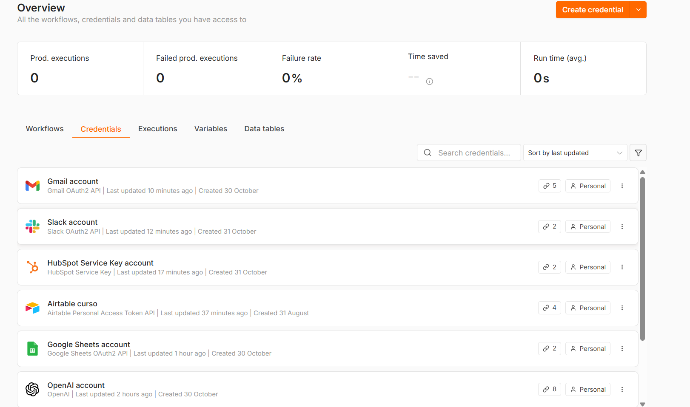

# Checkpoint 4: integraciones con HubSpot, Gmail y Slack

Evolución del agente del Módulo 3. El flujo mantiene el canal de chat con memoria en Airtable y suma un segundo canal: la casilla de soporte por correo, conectada al CRM, a Gmail y a Slack.

**Archivo para importar en n8n:** [checkpoint4_matias_martinez.json](checkpoint4_matias_martinez.json)

## Conexiones activas en n8n

| Herramienta | Rol en el caso | Credencial | Permisos |
|---|---|---|---|
| HubSpot | CRM, fuente única de verdad de los contactos | HubSpot Service Key | Solo `crm.objects.contacts.read` y `crm.objects.contacts.write` |
| Gmail | Casilla de soporte al cliente | Gmail OAuth2 | Lee solo los correos enviados al alias `+soporte` y crea borradores. No hay ningún nodo de envío |
| Slack | Canal del equipo de operaciones | Slack OAuth2 | Scopes personalizados: solo `chat:write` y `channels:read`, en vez de la lista completa que n8n pide por defecto |

**Nota sobre HubSpot:** HubSpot ya no permite crear apps OAuth "antiguas" en cuentas nuevas. Las reemplazó por claves de servicio y apps basadas en proyectos. Se usó una clave de servicio, que es el reemplazo oficial y además permite aplicar mínimo privilegio con solo dos permisos. La credencial OAuth2 de n8n para HubSpot exige una lista fija de trece permisos.

## Recorrido del canal de correo

1. **Correo entrante a soporte:** Gmail Trigger que revisa cada minuto los correos no leídos dirigidos a `matimartinezv+soporte@gmail.com`.
2. **① ¿Es respuesta automática?:** IF ubicado justo después del trigger. Corta el flujo si el asunto contiene Auto-reply, Automatic reply, Out of office, Fuera de la oficina, Undeliverable o Delivery Status Notification, si el remitente es no-reply, noreply o mailer-daemon, o si el correo trae la cabecera Auto-Submitted. Así se evita el bucle infinito de respuestas automáticas.
3. **Agente de soporte:** AI Agent en modo Tools Agent con GPT-4o y salida estructurada. Clasifica el correo (LEAD, CONSULTA, RECLAMO u OTRO), extrae nombre y empresa, resume la necesidad y redacta un borrador de respuesta. El contenido del correo va entre delimitadores para que no se lea como instrucciones.
4. **④ Limpiar y validar payload:** Set que deja solo email, nombre, empresa, asunto, cuerpo recortado, categoría, resumen y borrador, y valida el formato del email. Un IF descarta el caso si el email no es válido, para no enviar un payload mal formado al CRM y evitar el error 400.
5. **② Look up en HubSpot:** busca el contacto por email antes de escribir. Si existe, lo actualiza; si no, lo crea como lead. Así se evita el error 409 por contactos duplicados.
6. **③ Crear borrador de respuesta:** Gmail con la operación Create Draft en el mismo hilo del correo. Una persona revisa el borrador y decide si lo envía (Human-in-the-loop).
7. **Payload mínimo para Slack:** Set que arma un solo texto con categoría, remitente, asunto y resumen, sin el cuerpo completo ni adjuntos.
8. **Avisar a #operaciones:** mensaje en el canal de Slack del equipo.

## Pruebas realizadas

| Prueba | Resultado |
|---|---|
| Correo nuevo de un lead | Contacto creado en HubSpot, borrador en Gmail y aviso en Slack |
| El mismo correo por segunda vez | El Look up encontró el contacto y lo actualizó, sin duplicarlo |
| Correo "Automatic reply: Out of office" desde un no-reply | El IF lo derivó a "Ignorar: corta el bucle" y no se ejecutó nada más |
| Correo real enviado al alias de soporte | Procesado de punta a punta; el borrador se revisó y se envió a mano |

## Cómo importarlo

En n8n: **Import from File** y elegir el JSON. Después se conectan las credenciales propias de OpenAI, Airtable, Google Sheets, Gmail, HubSpot y Slack. El canal de correo se prueba con **Test this trigger** en el nodo "Correo entrante a soporte" y luego **Execute workflow**.

**Autor:** Matías Martínez
